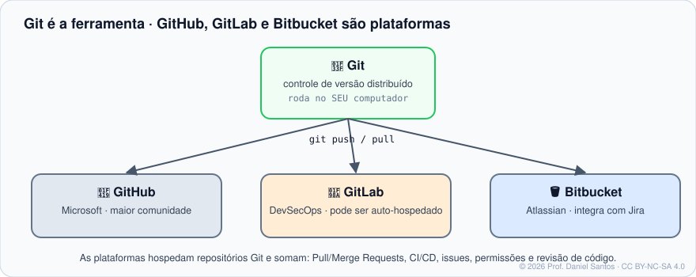

<div align="center">

# 🌿 Git do Zero ao Fluxo Profissional

### A jornada do desenvolvedor começa aqui — um curso aberto, prático e verificável de Git

*Material didático gratuito e aberto — para uso não comercial.*

[](LICENSE)
[](LICENSE-CONTEUDO.md)
[](https://github.com/dsantos-docencia/git/actions)
[](CONTRIBUTING.md)

</div>

---

## 👋 Boas-vindas

Olá! Eu sou o **Professor Daniel Santos** — desenvolvedor, provedor de serviços de tecnologia e professor de cursos técnicos de TI e segurança cibernética.

Este é o primeiro curso da **trilha da jornada do desenvolvedor**. Git é a ferramenta que todo time de software usa — e a que mais assusta quem começa, porque quase todo tutorial ensina *comandos* sem ensinar o *modelo*. Aqui é o contrário: você entende **as três áreas, o grafo de commits e as referências**, e os comandos passam a fazer sentido sozinhos.

Como nos meus cursos de [Bash](https://github.com/dsantos-docencia/Bash) e [PowerShell](https://github.com/dsantos-docencia/power-shell): cada conceito vem com **o porquê**, cada exemplo **roda de verdade** (uma esteira automática executa tudo a cada alteração) e cada exercício tem **correção automática**. E cada módulo termina com as **fontes oficiais** — o manual do Git e o livro Pro Git em português — para você aprender a consultar a fonte, não só este curso.

> *"Git não é difícil. Difícil é usar Git sem saber o que ele está guardando."* — Prof. Daniel

---

## 🧭 A trilha da jornada do desenvolvedor

| Curso | Foco | Repositório |
|---|---|---|
| **1 · Git** ← você está aqui | a ferramenta: versionar, ramificar, colaborar, investigar | [dsantos-docencia/git](https://github.com/dsantos-docencia/git) |
| 2 · GitHub | Pull Requests, Actions, segurança, comunidade open source | [dsantos-docencia/github](https://github.com/dsantos-docencia/github) *(em construção)* |
| 3 · GitLab | Merge Requests, CI/CD integrado, auto-hospedagem | [dsantos-docencia/gitlab](https://github.com/dsantos-docencia/gitlab) *(em construção)* |
| 4 · Bitbucket | integração com Jira, Pipelines, times Atlassian | [dsantos-docencia/bitbucket](https://github.com/dsantos-docencia/bitbucket) *(em construção)* |



---

## 🗺️ Trilha de aprendizado

Cada módulo tem: **teoria** com cenário, diagramas e fontes oficiais (`README.md`), **exemplos executáveis comentados** (`exemplos/`) e **exercícios com correção automática** (`exercicios/`).

| # | Módulo | O que você domina | Horas | Status |
|---|---|---|---|---|
| 00 | [Boas-vindas e fundamentos](modulos/00-boas-vindas-e-fundamentos/) | controle de versão, história, Git × plataformas, instalação, níveis de configuração, ajuda | 3–4 | ✅ |
| 01 | [Primeiro repositório](modulos/01-primeiro-repositorio/) | as três áreas, `add`/`commit` com intenção, mensagens, `.gitignore` | 4–5 | ✅ |
| 02 | [Histórico e diferenças](modulos/02-historico-e-diferencas/) | `log` sob medida, seleção de revisão, `diff`, `blame`, pickaxe | 4–5 | ✅ |
| 03 | [Desfazendo com segurança](modulos/03-desfazendo-com-seguranca/) | `restore`, `amend`, `reset` (3 modos), `revert`, `reflog`, `clean` | 4–5 | ✅ |
| 04 | Branches e merge | `switch`, HEAD, fast-forward × merge de três vias, `--no-ff`, `--squash` | 4–5 | 🚧 |
| 05 | Conflitos | anatomia do conflito, `zdiff3`, ferramentas, `rerere` | 3–4 | 🚧 |
| 06 | Remotos e colaboração | `clone`, `fetch`/`pull`/`push`, upstream, HTTPS × SSH, credenciais, fork | 5–6 | 🚧 |
| 07 | Reescrevendo o histórico | `rebase`, rebase interativo, `cherry-pick`, `--fixup`, regra de ouro | 4–5 | 🚧 |
| 08 | Fluxos, tags e releases | GitHub flow, Git Flow, trunk-based, Conventional Commits, SemVer, tags | 4–5 | 🚧 |
| 09 | Ferramentas avançadas | `stash`, `worktree`, `bisect`, submódulos, sparse checkout, Git LFS | 5–6 | 🚧 |
| 10 | Por dentro do Git | objetos, refs, packfiles, encanamento, SHA-256 e reftable | 4–5 | 🚧 |
| 11 | Segurança, hooks e automação | hooks, assinatura de commits, segredos, `.gitattributes`, Git no CI | 4–5 | 🚧 |

🧪 **Laboratório**: [laboratorio/](laboratorio/) — instalação passo a passo (Windows, macOS, Linux), container pronto e um **time simulado** (servidor + duas pessoas) para treinar remotos e conflitos sem internet.

🧰 **Scripts reais**: [scripts/](scripts/) — novo repositório no padrão, limpeza de branches, sincronizar fork, raio-X do repositório, caça a segredos, versão automática, changelog, hooks e backup espelhado. Todos testados.

📚 **Referência**: [referencia/](referencia/) — **cheat sheet com exemplos e variações**, “como desfazer” por situação, `.gitconfig` recomendado e comentado, glossário e curadoria de fontes oficiais.

---

## 🚦 Começando em 3 passos

```bash
# 1. Clone o repositório
git clone https://github.com/dsantos-docencia/git.git curso-git
cd curso-git

# 2. Rode um exemplo (tudo roda em pasta temporária — não toca no seu ~/.gitconfig)
bash modulos/00-boas-vindas-e-fundamentos/exemplos/01-ola-git.sh

# 3. Faça um exercício e corrija na hora
./ferramentas/corrigir.sh 01        # todos os exercícios do módulo 01
./ferramentas/corrigir.sh 01 02     # só o exercício 02
```

No Windows, use o **Git Bash** (vem com o Git). Ambiente idêntico ao do professor: `./laboratorio/entrar.sh` (Docker).

---

## 🧰 O que torna este repositório diferente

- **Tudo roda.** O [GitHub Actions](.github/workflows/verificar.yml) executa ShellCheck, **todos** os exemplos, as soluções contra os testes e os testes dos scripts reais a cada push.
- **Correção automática que entende Git.** O corretor monta repositórios de verdade, roda o seu script e inspeciona commits, área de preparação, refs e reflog — e explica o que faltou.
- **Ambiente isolado.** Exemplos e testes usam configuração própria: o resultado é o mesmo em qualquer máquina, e o seu `~/.gitconfig` nunca é tocado.
- **Fonte oficial em cada módulo.** Links diretos para o manual (`git-scm.com/docs`) e para o capítulo certo do Pro Git em português.
- **Diagramas originais** em [assets/](assets/), licenciados junto com o conteúdo.

---

## 🤝 Contribuindo

> **Junte-se a mim e deixe algo de útil para o próximo.** 🌱 Conhecimento que não é compartilhado morre com quem o guarda.

- **Achou um erro ou tem uma ideia?** [Abra uma issue](https://github.com/dsantos-docencia/git/issues/new/choose) ou mande um PR.
- **Tem um script de Git útil?** Envie pela trilha **“📜 Enviar um script para a comunidade”** — os aprovados entram em [`scripts/comunidade/`](scripts/comunidade/) com o seu crédito.
- **Fala outro idioma?** Ajude a traduzir ([guia](traducoes/README.md)). A versão em inglês está nos planos.

Leia o [guia de contribuição](CONTRIBUTING.md). Quem contribui entra em [CONTRIBUTORS.md](CONTRIBUTORS.md). 💚

---

## 📜 Licença e direitos

- **Código** (scripts, ferramentas, exemplos): [PolyForm Noncommercial 1.0.0](LICENSE).
- **Conteúdo didático** (textos, exercícios, diagramas): [CC BY-NC-SA 4.0](LICENSE-CONTEUDO.md).
- **Uso comercial não é permitido** sem autorização do autor — veja o [NOTICE](NOTICE.md).
- Trechos e referências ao livro **Pro Git** (Scott Chacon e Ben Straub) seguem a licença do livro, CC BY-NC-SA 3.0; o curso **cita e aponta** para ele, sem reproduzi-lo.

© 2026 **Daniel Santos (Prof. Daniel Santos)** — todos os direitos reservados ao autor; as licenças acima são concedidas ao público.
