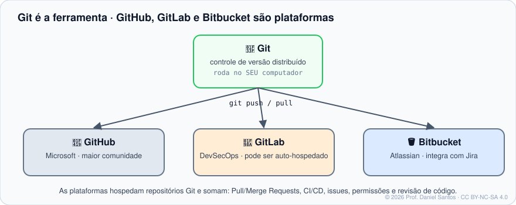
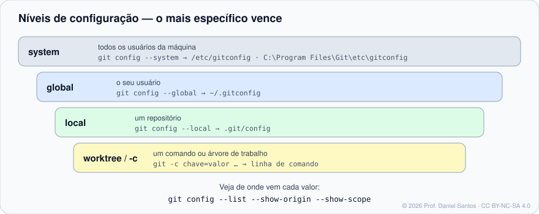

# Módulo 00 · Boas-vindas e fundamentos

> **Você vai sair daqui sabendo:** o que é controle de versão e por que todo profissional usa; de onde veio o Git; a diferença entre Git e GitHub/GitLab/Bitbucket; como instalar, configurar sua identidade e pedir ajuda ao próprio Git.

⏱ 3–4 h · 🧪 [Laboratório](../../laboratorio/) · ✍️ [Exercícios](exercicios/)

---

## 1. O problema que o Git resolve

Todo mundo já viu uma pasta assim:

```text
relatorio.docx
relatorio-final.docx
relatorio-final-AGORA-VAI.docx
relatorio-final-revisado-joao.docx
```

Isso é **controle de versão manual**: funciona até a hora em que você precisa responder “o que mudou entre a versão de segunda e a de hoje?”, “quem apagou aquele parágrafo?” ou “como junto as mudanças do João com as minhas?”.

Um **sistema de controle de versão (VCS)** guarda cada estado do projeto como uma “foto” com data, autor e motivo, permite voltar a qualquer foto e juntar o trabalho de várias pessoas. Em desenvolvimento de software isso não é opcional: é a base de revisão de código, integração contínua, auditoria e deploy.

| Geração | Exemplos | Como funciona | Limitação |
|---|---|---|---|
| Local | RCS | histórico só na sua máquina | não colabora |
| Centralizado | CVS, Subversion (SVN) | um servidor guarda o histórico; você faz *checkout* | servidor fora do ar = ninguém trabalha |
| **Distribuído** | **Git**, Mercurial | **cada cópia é o repositório inteiro**, com todo o histórico | curva de aprendizado inicial |

## 2. Uma história curta (e por que ela explica o Git)

Em 2005 o kernel Linux perdeu o direito de uso gratuito da ferramenta que usava (BitKeeper). Linus Torvalds escreveu o Git em poucas semanas com metas claras: **velocidade**, **design simples**, **suporte forte a desenvolvimento não linear** (milhares de branches paralelas), **totalmente distribuído** e capaz de lidar com projetos enormes. Em 2005 mesmo, a manutenção passou para **Junio C. Hamano**, que lidera o projeto até hoje.

Essas metas explicam escolhas que parecem estranhas no começo: branches são baratíssimas, quase tudo é local (e instantâneo) e o histórico é protegido por hashes criptográficos — mudar um commit antigo muda a identidade de todos os seguintes.

> 📌 **Onde estamos (nov/2026):** a série estável é a 2.5x (2.56 saiu em set/2026). O projeto documenta mudanças para o **Git 3.0**, ainda sem data: branch inicial `main` por padrão, **SHA-256** como hash padrão em repositórios novos e o formato **reftable** para referências. Repositórios existentes continuam funcionando. Fonte: [BreakingChanges](https://git-scm.com/docs/BreakingChanges).

## 3. Git não é GitHub



- **Git** é o programa que roda no seu computador e guarda o histórico na pasta `.git`. Funciona 100% offline.
- **GitHub, GitLab e Bitbucket** são **plataformas** que hospedam repositórios Git e acrescentam colaboração: Pull/Merge Requests, revisão de código, issues, CI/CD, permissões. Cada uma tem um curso próprio nesta trilha.

Aprender Git primeiro é o que faz as plataformas deixarem de ser “mágica”: um botão “Merge” é um `git merge`; “Sync fork” é `git fetch` + `git merge`.

## 4. Instalação

| Sistema | Como instalar | Observação |
|---|---|---|
| **Windows** | instalador oficial em [git-scm.com/downloads](https://git-scm.com/downloads) ou `winget install --id Git.Git -e` | traz o **Git Bash** (terminal Bash) e o Git Credential Manager |
| **macOS** | `xcode-select --install` (versão da Apple) ou `brew install git` (mais recente) | |
| **Debian/Ubuntu** | `sudo apt install git` | para a versão mais nova: PPA `git-core/ppa` |
| **Fedora/RHEL** | `sudo dnf install git` | |
| **Sem instalar nada** | [laboratório em container](../../laboratorio/) | ambiente idêntico ao do professor |

Confira: `git --version`. Qualquer versão **2.28+** serve para o curso (é a partir dela que `git init -b main` existe); o laboratório usa a mais recente do Debian.

## 5. Configuração: quem é você?

Todo commit carrega **nome e e-mail** do autor. Sem isso, o Git recusa o commit (ou adivinha algo errado a partir do nome da máquina).

```bash
git config --global user.name  "Seu Nome"
git config --global user.email "voce@exemplo.com"
git config --global init.defaultBranch main     # branch inicial dos repositórios novos
git config --global core.editor "code --wait"   # ou nano, vim, notepad++
git config --global pull.rebase false           # comportamento explícito do pull (Módulo 06)
```

### Os níveis de configuração



| Nível | Opção | Arquivo | Vale para |
|---|---|---|---|
| system | `--system` | `/etc/gitconfig` (Windows: na pasta de instalação) | todos os usuários da máquina |
| global | `--global` | `~/.gitconfig` | o seu usuário |
| local | `--local` (padrão dentro de um repo) | `.git/config` | aquele repositório |
| comando | `git -c chave=valor …` | — | só aquela execução |

**O mais específico vence.** Caso típico: e-mail pessoal no `--global` e e-mail da empresa no `--local` do repositório do trabalho.

```bash
git config --list --show-origin --show-scope   # tudo, com a origem de cada valor
git config --get user.email                     # o valor efetivo
git config --unset --global core.editor         # remove
```

> 💡 **Profissional:** `includeIf` aplica um arquivo de configuração só em certas pastas — por exemplo, tudo em `~/trabalho/` usa o e-mail corporativo:
> ```ini
> # ~/.gitconfig
> [includeIf "gitdir:~/trabalho/"]
>     path = ~/.gitconfig-trabalho
> ```

### Fim de linha (Windows × Linux)

Windows usa `CRLF`, Linux/macOS usam `LF`. Misturar gera diffs “mudou o arquivo inteiro”. Recomendação:

- Windows: `git config --global core.autocrlf true`
- Linux/macOS: `git config --global core.autocrlf input`
- Melhor ainda: um arquivo `.gitattributes` no repositório (Módulo 11) — vale para todo o time, independentemente da máquina.

## 6. Pedindo ajuda ao próprio Git

| Comando | O que mostra |
|---|---|
| `git help <comando>` ou `git <comando> --help` | o manual completo (no Windows, abre no navegador) |
| `git <comando> -h` | resumo das opções, direto no terminal |
| `git help -g` | guias conceituais (ex.: `git help tutorial`, `git help glossary`) |
| `git help -a` | todos os comandos disponíveis |

Os manuais oficiais estão em <https://git-scm.com/docs> — os mesmos textos do `git help`, com links.

## 7. Porcelana × encanamento

O Git tem dois tipos de comando:

- **Porcelana** (*porcelain*): para pessoas — `status`, `add`, `commit`, `log`, `switch`. A saída pode mudar entre versões.
- **Encanamento** (*plumbing*): para scripts — `rev-parse`, `rev-list`, `cat-file`, `for-each-ref`. Saída estável.

Regra para scripts: prefira encanamento ou as opções `--porcelain`/`--format` da porcelana. Você vai ver isso nos exemplos e nos [scripts reais](../../scripts/) do curso.

## 8. Mão na massa

| Exemplo | O que demonstra |
|---|---|
| [`01-ola-git.sh`](exemplos/01-ola-git.sh) | versão, primeiro repositório e a pasta `.git` |
| [`02-niveis-de-config.sh`](exemplos/02-niveis-de-config.sh) | global × local × `-c`, e quem vence |
| [`03-pedindo-ajuda.sh`](exemplos/03-pedindo-ajuda.sh) | `-h`, guias e listagem de comandos |

```bash
bash modulos/00-boas-vindas-e-fundamentos/exemplos/01-ola-git.sh
```

Todos os exemplos rodam numa pasta temporária e **não tocam no seu `~/.gitconfig`**.

## 9. Exercícios

Veja [exercicios/README.md](exercicios/). Corrija com:

```bash
./ferramentas/corrigir.sh 00
```

## 10. Boas práticas e armadilhas

- ✅ Use o **mesmo e-mail** cadastrado na plataforma (GitHub/GitLab/Bitbucket) — é assim que ela associa os commits ao seu perfil.
- ✅ Defina `init.defaultBranch main` agora; evita a confusão `master`/`main` nos primeiros repositórios.
- ⚠️ Não coloque senha ou token em `git config`. Credenciais ficam no *credential helper* (Módulo 06).
- ⚠️ Se você usa computador compartilhado, configure identidade no nível **local** de cada repositório, não no global.

## 📚 Fontes oficiais

- Pro Git (Scott Chacon e Ben Straub, CC BY-NC-SA 3.0), em português: [1.1 Sobre controle de versão](https://git-scm.com/book/pt-br/v2/Primeiros-Passos-Sobre-Controle-de-Vers%c3%a3o) · [1.2 Uma breve história do Git](https://git-scm.com/book/pt-br/v2/Primeiros-Passos-Uma-Breve-Hist%c3%b3ria-do-Git) · [1.5 Instalando o Git](https://git-scm.com/book/pt-br/v2/Primeiros-Passos-Instalando-o-Git) · [1.6 Configuração inicial](https://git-scm.com/book/pt-br/v2/Primeiros-Passos-Configura%c3%a7%c3%a3o-inicial-do-Git) · [1.7 Obtendo ajuda](https://git-scm.com/book/pt-br/v2/Primeiros-Passos-Obtendo-Ajuda)
- Manual: [git-config](https://git-scm.com/docs/git-config) · [git-help](https://git-scm.com/docs/git-help) · [gitglossary](https://git-scm.com/docs/gitglossary)
- Mudanças planejadas para o Git 3.0: [BreakingChanges](https://git-scm.com/docs/BreakingChanges)
- Downloads oficiais: [git-scm.com/downloads](https://git-scm.com/downloads)

---

➡️ Próximo: [Módulo 01 · Primeiro repositório](../01-primeiro-repositorio/)

<sub>© 2026 Prof. Daniel Santos · conteúdo [CC BY-NC-SA 4.0](../../LICENSE-CONTEUDO.md) · código [PolyForm Noncommercial](../../LICENSE)</sub>
