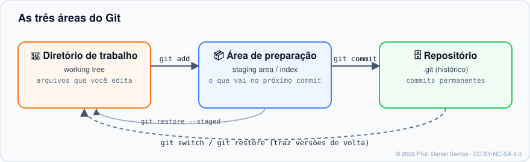

# Módulo 01 · Primeiro repositório

> **Você vai sair daqui sabendo:** criar um repositório, entender as **três áreas** do Git, montar commits de propósito (não “tudo de uma vez”), escrever boas mensagens e ignorar o que não deve ser versionado.

⏱ 4–5 h · 🧪 [Laboratório](../../laboratorio/) · ✍️ [Exercícios](exercicios/)

---

## 1. Cenário

Você entrou numa equipe e vai começar um serviço novo, a `api-pedidos`. Antes da primeira linha de código, o repositório precisa existir, ter um README e ignorar arquivos de log, dependências e segredos. Este módulo é exatamente esse primeiro dia.

## 2. As três áreas — o conceito mais importante do curso



| Área | Nome em inglês | O que é |
|---|---|---|
| Diretório de trabalho | *working tree* | os arquivos que você vê e edita |
| Área de preparação | *staging area*, *index* | a “bandeja” com o que vai no **próximo** commit |
| Repositório | *repository* (`.git`) | os commits, permanentes e com histórico |

**Por que existe a área de preparação?** Porque um commit deve contar **uma** história. Você corrigiu um bug e, no mesmo arquivo de trabalho, começou uma funcionalidade nova? Com o `add` você escolhe o que entra agora e deixa o resto para outro commit. Commits pequenos e coesos tornam revisão, `revert` e `bisect` (Módulo 09) muito mais fáceis.

### Os estados de um arquivo

```text
 não rastreado ──git add──▶ preparado ──git commit──▶ não modificado
                               ▲                          │ (você edita)
                               └──────── git add ◀── modificado
```

`git status` mostra em qual estado cada arquivo está. Leia a saída com calma: ela quase sempre diz o próximo comando.

## 3. Comandos do módulo (com variações)

| Comando | Para quê | Variações úteis |
|---|---|---|
| `git init -b main [pasta]` | cria um repositório | `--bare` (servidor, Módulo 06) · `--object-format=sha256` |
| `git status` | estado das três áreas | `-s` (curto) · `-sb` (curto + branch) · `--porcelain` (para scripts) |
| `git add <arq>` | prepara | `git add .` (tudo na pasta) · `git add -p` (escolhe **trechos**) · `git add -u` (só rastreados) |
| `git commit -m "msg"` | grava a foto | `git commit` (abre o editor) · `-a` (add + commit dos rastreados) · `--amend` (Módulo 03) |
| `git rm <arq>` | apaga e prepara a remoção | `--cached` (para de rastrear, mantém o arquivo) |
| `git mv <de> <para>` | renomeia e prepara | equivale a `mv` + `git add` |
| `git diff` | o que mudou e **não** foi preparado | `--staged` (o que vai no commit) |

> ⚠️ `git add .` é prático, mas é a origem nº 1 de commits com lixo (logs, `.env`, `node_modules`). Rode `git status` **antes** de commitar — sempre.

## 4. Mensagens de commit que ajudam

Uma mensagem é escrita para alguém daqui a seis meses (provavelmente você). Padrão consagrado:

```text
feat: calcula frete por CEP                       ← resumo ≤ 50 caracteres, imperativo

O frete passa a usar a tabela da transportadora   ← corpo: o PORQUÊ, não o "como"
em vez do valor fixo. Pedidos sem CEP continuam
com o valor padrão.

Refs: #142                                        ← rodapé: tickets, co-autores
```

- Resumo no **imperativo** (“adiciona”, “corrige”), como se completasse a frase “este commit…”.
- Prefixos do **Conventional Commits** (`feat:`, `fix:`, `docs:`, `refactor:`, `test:`, `chore:`) permitem gerar changelog e versão automaticamente (Módulo 08). Especificação: [conventionalcommits.org](https://www.conventionalcommits.org/pt-br/v1.0.0/).
- ❌ Evite: `ajustes`, `wip`, `aaa`, `commit final 2`.

## 5. `.gitignore`: o que nunca entra

```gitignore
# dependências e builds (são recriados a partir do código)
node_modules/
build/
*.pyc

# logs e arquivos temporários
*.log
.DS_Store
Thumbs.db

# segredos — NUNCA versione
.env
*.pem
```

| Padrão | Significa |
|---|---|
| `*.log` | qualquer arquivo terminado em `.log`, em qualquer pasta |
| `build/` | a pasta `build` (e tudo dentro) |
| `/config.local` | só na raiz do repositório |
| `!importante.log` | exceção: **volta** a incluir |
| `docs/**/*.tmp` | `.tmp` em qualquer nível dentro de `docs/` |

- Modelos prontos por linguagem: [github/gitignore](https://github.com/github/gitignore).
- Ignorar só na sua máquina, sem afetar o time: `.git/info/exclude`.
- Ignorar em todos os seus repositórios: `git config --global core.excludesFile ~/.gitignore_global`.
- **O `.gitignore` não age sobre arquivos já rastreados.** Commitou o `.env` sem querer? `git rm --cached .env`, commite, e **troque a senha** — ela está no histórico (Módulo 11 mostra como limpar).

Diagnóstico: `git check-ignore -v arquivo` mostra **qual linha** de qual `.gitignore` está ignorando o arquivo.

## 6. Mão na massa

| Exemplo | O que demonstra |
|---|---|
| [`01-tres-areas.sh`](exemplos/01-tres-areas.sh) | um arquivo passando por todos os estados, com `status --short` a cada passo |
| [`02-gitignore-na-pratica.sh`](exemplos/02-gitignore-na-pratica.sh) | padrões, exceção com `!`, `check-ignore -v` e o caso “já estava rastreado” |
| [`03-commits-coesos.sh`](exemplos/03-commits-coesos.sh) | separar duas mudanças em dois commits, `rm`, `mv` e `rm --cached` |

## 7. Exercícios

[exercicios/README.md](exercicios/) · `./ferramentas/corrigir.sh 01`

## 8. Boas práticas e armadilhas

- ✅ Crie o `.gitignore` **no primeiro commit**, antes de qualquer `git add .`.
- ✅ Um commit = uma intenção. Se a mensagem precisa de “e”, talvez sejam dois commits.
- ✅ Leia `git diff --staged` antes de commitar: é a sua última revisão.
- ⚠️ Arquivos binários grandes (vídeos, dumps de banco) não pertencem ao Git comum — veja Git LFS no Módulo 09.
- ⚠️ Pastas vazias não são versionadas: o Git rastreia **arquivos**. Convenção: um `.gitkeep` dentro.

## 📚 Fontes oficiais

- Pro Git: [2.1 Obtendo um repositório](https://git-scm.com/book/pt-br/v2/Fundamentos-do-Git-Obtendo-um-Reposit%c3%b3rio-Git) · [2.2 Gravando alterações](https://git-scm.com/book/pt-br/v2/Fundamentos-do-Git-Gravando-Altera%c3%a7%c3%b5es-no-Reposit%c3%b3rio) · [7.2 Área de stage interativa](https://git-scm.com/book/pt-br/v2/Ferramentas-do-Git-%c3%81rea-de-Stage-Interativa)
- Manual: [git-init](https://git-scm.com/docs/git-init) · [git-add](https://git-scm.com/docs/git-add) · [git-commit](https://git-scm.com/docs/git-commit) · [git-status](https://git-scm.com/docs/git-status) · [gitignore](https://git-scm.com/docs/gitignore) · [git-check-ignore](https://git-scm.com/docs/git-check-ignore)
- [Conventional Commits 1.0.0 (pt-br)](https://www.conventionalcommits.org/pt-br/v1.0.0/) · modelos [github/gitignore](https://github.com/github/gitignore)

---

⬅️ [Módulo 00](../00-boas-vindas-e-fundamentos/) · ➡️ [Módulo 02 · Histórico e diferenças](../02-historico-e-diferencas/)

<sub>© 2026 Prof. Daniel Santos · conteúdo [CC BY-NC-SA 4.0](../../LICENSE-CONTEUDO.md) · código [PolyForm Noncommercial](../../LICENSE)</sub>
