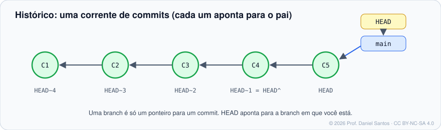

# Módulo 02 · Histórico e diferenças

> **Você vai sair daqui sabendo:** navegar no histórico como um detetive — filtrar commits por autor, data, arquivo e conteúdo; apontar para qualquer versão (`HEAD~2`, `main..feature`); comparar versões com `diff`; e descobrir **quem** mudou **o quê**, **quando** e **por quê**.

⏱ 4–5 h · ✍️ [Exercícios](exercicios/)

---

## 1. Cenário

Segunda-feira, 9h: o cálculo de imposto da loja está errado em produção. Você precisa responder rápido: *quando* a taxa mudou, *quem* mudou, *em qual commit* e *o que mais* veio junto. Tudo isso está no histórico — se você souber perguntar.

## 2. O histórico é um grafo de commits



Cada commit guarda: a foto completa do projeto, autor, data, mensagem e **o(s) commit(s) pai**. Uma branch é só um ponteiro para o commit mais recente da linha; `HEAD` aponta para a branch em que você está.

### Como apontar para um commit (seleção de revisão)

| Forma | Significa | Exemplo |
|---|---|---|
| hash (completo ou curto) | um commit específico | `a1b2c3d` |
| branch / tag | o commit para onde aponta | `main`, `v1.2.0` |
| `HEAD~n` | n gerações atrás, seguindo o 1º pai | `HEAD~3` |
| `HEAD^` / `HEAD^2` | 1º pai / 2º pai (em commits de merge) | `HEAD^2` |
| `A..B` | commits em B que **não** estão em A | `main..feature` = “o que a feature trouxe” |
| `A...B` | commits em um **ou** outro, não em ambos | divergência entre duas branches |
| `@{n}` / `@{1.day.ago}` | posição antiga da branch (reflog) | `main@{yesterday}` |
| `:/texto` | o commit mais recente cuja mensagem contém o texto | `:/frete` |

## 3. `git log` — perguntas e respostas

| Pergunta | Comando |
|---|---|
| Visão geral compacta | `git log --oneline --graph --decorate --all` |
| Últimos 5 commits | `git log -5` |
| Commits da Bia | `git log --author="Bia"` |
| Da última semana | `git log --since="1 week ago"` · `--until="2026-11-01"` |
| Que mencionam “frete” na mensagem | `git log --grep="frete" -i` |
| Que tocaram um arquivo | `git log -- caminho/arquivo.py` |
| …mesmo depois de renomeado | `git log --follow -- arquivo.py` |
| Que **adicionaram ou removeram** um texto (*pickaxe*) | `git log -S"TAXA=0.15"` |
| Cujo diff casa com um regex | `git log -G"TAXA=[0-9.]+"` |
| Só merges / sem merges | `--merges` / `--no-merges` |
| Quem mais commitou | `git shortlog -sn` |
| Formato personalizado | `git log --format='%h %an %ar %s'` |

Marcadores de `--format` mais usados: `%H` hash, `%h` hash curto, `%an` autor, `%ae` e-mail, `%ad`/`%ar` data absoluta/relativa, `%s` assunto, `%b` corpo, `%d` decorações. Lista completa em [git-log › PRETTY FORMATS](https://git-scm.com/docs/git-log#_pretty_formats).

> 💡 Alias que vale a pena: `git config --global alias.lg "log --oneline --graph --decorate --all"` → `git lg`.

## 4. `git show` — abrir um commit

```bash
git show HEAD                 # metadados + diff do último commit
git show v1.0 --stat          # resumo: arquivos e linhas alteradas
git show HEAD~2:config.ini    # o CONTEÚDO do arquivo naquela versão
git show :config.ini          # o conteúdo na área de preparação
```

## 5. `git diff` — os três sabores (e mais)

| Comando | Compara |
|---|---|
| `git diff` | diretório de trabalho × preparação (o que você ainda não deu `add`) |
| `git diff --staged` | preparação × último commit (o que vai entrar no commit) |
| `git diff HEAD` | diretório de trabalho × último commit (tudo junto) |
| `git diff A B` | dois commits/branches/tags |
| `git diff main...feature` | a partir do ancestral comum (o que a feature mudou) |
| `git diff --stat` · `--name-only` · `--name-status` | só o resumo / os nomes / nomes com A/M/D/R |
| `git diff --word-diff` | diferença palavra a palavra (ótimo para texto) |
| `git diff -w` | ignora mudanças só de espaço |

### Lendo um diff

```diff
diff --git a/config.ini b/config.ini
--- a/config.ini              ← versão antiga
+++ b/config.ini              ← versão nova
@@ -2,3 +2,3 @@               ← trecho: a partir da linha 2, 3 linhas (antes e depois)
 MOEDA=BRL                    ← linha de contexto (igual)
-TAXA=0.12                    ← removida
+TAXA=0.15                    ← adicionada
```

## 6. Quem mudou isto? `blame` e `grep`

```bash
git blame config.ini              # cada linha com o commit, autor e data que a escreveu por último
git blame -L 10,20 app.py         # só as linhas 10 a 20
git blame -w -C app.py            # ignora espaços e detecta código movido/copiado
git grep -n "TAXA"                # busca no código rastreado (mais rápido que grep -r)
git grep "TAXA" v1.0              # busca numa versão antiga
```

> 🧠 `blame` não é para culpar ninguém: é para achar o **commit** — e a mensagem dele explica o porquê. Por isso mensagens boas (Módulo 01) importam tanto.
> Commits só de formatação poluem o blame. Liste-os num arquivo `.git-blame-ignore-revs` e use `git config blame.ignoreRevsFile .git-blame-ignore-revs`.

## 7. Mão na massa

| Exemplo | O que demonstra |
|---|---|
| [`01-log-sob-medida.sh`](exemplos/01-log-sob-medida.sh) | filtros de `log`, `--format`, `shortlog` e seleção de revisão |
| [`02-diff-em-todos-os-sabores.sh`](exemplos/02-diff-em-todos-os-sabores.sh) | `diff`, `--staged`, entre commits, `--stat`, `--word-diff` |
| [`03-investigacao.sh`](exemplos/03-investigacao.sh) | o caso da taxa: `log -S`, `show`, `blame`, `grep` |

## 8. Exercícios

[exercicios/README.md](exercicios/) · `./ferramentas/corrigir.sh 02`

## 9. Boas práticas e armadilhas

- ✅ Em scripts, use `--format`/`--porcelain` ou comandos de encanamento (`rev-list`, `rev-parse`); a saída “bonita” muda entre versões.
- ✅ `git log -p -- arquivo` é a forma mais rápida de entender a evolução de um arquivo.
- ⚠️ `A..B` e `A...B` significam coisas **diferentes** em `log` e em `diff`. Na dúvida, leia a seção “SPECIFYING RANGES” de [gitrevisions](https://git-scm.com/docs/gitrevisions).
- ⚠️ Datas de commit podem mentir (relógio errado, rebase). Para auditoria, o hash e a ordem do grafo valem mais que a data.

## 📚 Fontes oficiais

- Pro Git: [2.3 Visualizando o histórico](https://git-scm.com/book/pt-br/v2/Fundamentos-do-Git-Visualizando-o-Hist%c3%b3rico-de-Commits) · [7.1 Seleção de revisão](https://git-scm.com/book/pt-br/v2/Ferramentas-do-Git-Sele%c3%a7%c3%a3o-de-Revis%c3%a3o) · [7.5 Pesquisando](https://git-scm.com/book/pt-br/v2/Ferramentas-do-Git-Pesquisando-Searching)
- Manual: [git-log](https://git-scm.com/docs/git-log) · [git-show](https://git-scm.com/docs/git-show) · [git-diff](https://git-scm.com/docs/git-diff) · [git-blame](https://git-scm.com/docs/git-blame) · [git-grep](https://git-scm.com/docs/git-grep) · [gitrevisions](https://git-scm.com/docs/gitrevisions) · [git-shortlog](https://git-scm.com/docs/git-shortlog)

---

⬅️ [Módulo 01](../01-primeiro-repositorio/) · ➡️ [Módulo 03 · Desfazendo com segurança](../03-desfazendo-com-seguranca/)

<sub>© 2026 Prof. Daniel Santos · conteúdo [CC BY-NC-SA 4.0](../../LICENSE-CONTEUDO.md) · código [PolyForm Noncommercial](../../LICENSE)</sub>
