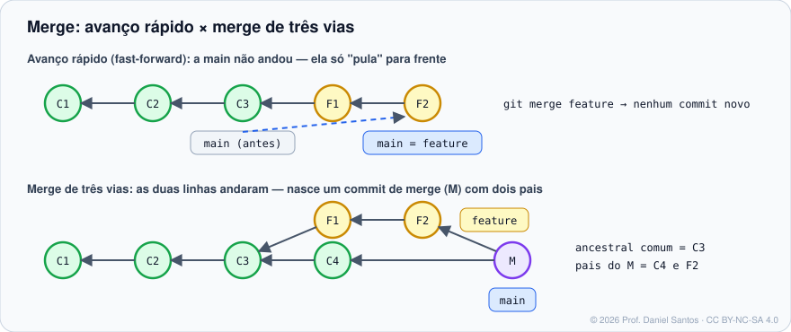

# Módulo 04 · Branches e merge

> **Você vai sair daqui sabendo:** o que uma branch realmente é (um ponteiro de 41 bytes), criar e alternar branches com `switch`, entender o HEAD destacado, e mesclar com consciência — avanço rápido, merge de três vias, `--no-ff` e `--squash`.

⏱ 4–5 h · ✍️ [Exercícios](exercicios/)

---

## 1. Cenário

A `main` da loja está em produção. Você vai desenvolver o cálculo de frete por CEP, que leva uma semana, enquanto um colega corrige um bug urgente no carrinho. Se os dois trabalharem direto na `main`, um atrapalha o outro e nada pode ser publicado pela metade. **Branches** isolam cada linha de trabalho até ela estar pronta.

## 2. O que é uma branch

Uma branch é um **ponteiro** com o hash de um commit — no formato tradicional, literalmente um arquivo em `.git/refs/heads/` (no formato *reftable*, padrão previsto para o Git 3.0, fica numa tabela; Módulo 10). Só isso. Criar uma branch é instantâneo e não copia nada.

```bash
git switch -c feature/frete-cep     # cria e muda para a nova branch
cat .git/refs/heads/feature/frete-cep   # → um hash de 40 caracteres
```

Quando você commita, a branch **em que o HEAD está** avança para o commit novo. As outras ficam paradas.

| Conceito | O que é |
|---|---|
| `HEAD` | “você está aqui”: normalmente aponta para uma branch (`ref: refs/heads/main`) |
| HEAD destacado (*detached*) | HEAD aponta direto para um commit (ex.: `git switch --detach v1.0`). Commits feitos aqui ficam “órfãos” se você sair sem criar uma branch |
| Branch atual | `git branch --show-current` |

## 3. Comandos de branch

| Comando | Para quê | Variações |
|---|---|---|
| `git branch` | lista | `-v` (último commit) · `-vv` (com upstream) · `-a` (com remotas) · `--merged` / `--no-merged` |
| `git switch -c nome` | cria e troca | `git switch -c nome <commit>` (a partir de outro ponto) |
| `git switch nome` | troca | `git switch -` (volta para a anterior) |
| `git branch -m velho novo` | renomeia | `-M` (força) |
| `git branch -d nome` | apaga se já mesclada | `-D` (força, mesmo não mesclada) |

> Convenção de nomes muito usada: `feature/…`, `fix/…`, `hotfix/…`, `docs/…`, com letras minúsculas e hífens. Combine com o time — e com os prefixos das mensagens (Conventional Commits).

> `git checkout` também troca de branch (e restaura arquivos). Desde o Git 2.23, prefira `switch` (branches) e `restore` (arquivos): cada comando faz uma coisa só.

## 4. Os dois tipos de merge



**Avanço rápido (*fast-forward*)** — se a `main` não mudou desde que a feature saiu dela, o Git só move o ponteiro da `main` para frente. Nenhum commit novo.

**Merge de três vias** — se as duas linhas andaram, o Git compara três versões: o **ancestral comum** e as pontas das duas branches. Cria um **commit de merge** com dois pais. Se o mesmo trecho mudou dos dois lados, há **conflito** (Módulo 05).

| Opção | Efeito | Quando usar |
|---|---|---|
| `git merge feature` | ff se possível; senão, três vias | padrão |
| `--no-ff` | sempre cria commit de merge | registrar que “aqui entrou a feature X” (Git Flow) |
| `--ff-only` | só aceita avanço rápido; senão falha | manter histórico linear (combine com rebase, Módulo 07) |
| `--squash` | junta todas as mudanças num único commit **novo** na branch atual (sem ligação com a feature) | features com commits bagunçados |
| `--abort` | cancela um merge em andamento | conflito complicado, quero recomeçar |

```bash
git switch main
git merge --no-ff feature/frete-cep -m "Merge: frete por CEP"
git branch -d feature/frete-cep        # a branch já cumpriu o papel
git log --oneline --graph              # veja a "bolha" do merge
```

> As plataformas oferecem os mesmos três botões no Pull/Merge Request: **Create a merge commit** (`--no-ff`), **Squash and merge** (`--squash`) e **Rebase and merge** (Módulo 07). Agora você sabe o que cada um faz.

## 5. Quanto tempo uma branch deve viver?

Quanto mais tempo longe da `main`, maior o conflito na volta. Prática recomendada: branches **curtas** (horas ou poucos dias), integrando a `main` com frequência e escondendo funcionalidades incompletas atrás de *feature flags*. Detalhes em fluxos de trabalho (Módulo 08).

## 6. Mão na massa

| Exemplo | O que demonstra |
|---|---|
| [`01-branch-e-ponteiro.sh`](exemplos/01-branch-e-ponteiro.sh) | branch como arquivo, HEAD, commits avançando só a branch atual, HEAD destacado |
| [`02-fast-forward-e-tres-vias.sh`](exemplos/02-fast-forward-e-tres-vias.sh) | os dois tipos de merge no mesmo roteiro, com `--graph` |
| [`03-no-ff-e-squash.sh`](exemplos/03-no-ff-e-squash.sh) | o mesmo trabalho integrado com `--no-ff` e com `--squash` — compare os históricos |

## 7. Exercícios

[exercicios/README.md](exercicios/) · `./ferramentas/corrigir.sh 04`

## 8. Boas práticas e armadilhas

- ✅ Antes de criar uma branch, atualize a base: `git switch main && git pull`.
- ✅ Apague branches mescladas (local e no servidor) — veja [`scripts/dia-a-dia/limpar-branches-mescladas.sh`](../../scripts/dia-a-dia/limpar-branches-mescladas.sh).
- ⚠️ Mudanças não commitadas “viajam” com você ao trocar de branch; se conflitarem, o Git recusa a troca. Commit ou `git stash` (Módulo 09).
- ⚠️ Em HEAD destacado, crie uma branch antes de sair (`git switch -c nome`) para não deixar commits órfãos — se esquecer, o `reflog` salva.

## 📚 Fontes oficiais

- Pro Git: [3.1 Branches em poucas palavras](https://git-scm.com/book/pt-br/v2/Ramifica%c3%a7%c3%a3o-Branching-no-Git-Branches-em-Poucas-Palavras) · [3.2 Ramificação e mesclagem básicas](https://git-scm.com/book/pt-br/v2/Ramifica%c3%a7%c3%a3o-Branching-no-Git-Ramifica%c3%a7%c3%a3o-Branching-e-Mesclagem-Merging-B%c3%a1sicas) · [3.3 Gerenciamento de branches](https://git-scm.com/book/pt-br/v2/Ramifica%c3%a7%c3%a3o-Branching-no-Git-Gerenciamento-de-Branches)
- Manual: [git-branch](https://git-scm.com/docs/git-branch) · [git-switch](https://git-scm.com/docs/git-switch) · [git-merge](https://git-scm.com/docs/git-merge)
- Visual e interativo: [Learn Git Branching](https://learngitbranching.js.org/?locale=pt_BR)

---

⬅️ [Módulo 03](../03-desfazendo-com-seguranca/) · ➡️ [Módulo 05 · Conflitos](../05-conflitos/)

<sub>© 2026 Prof. Daniel Santos · conteúdo [CC BY-NC-SA 4.0](../../LICENSE-CONTEUDO.md) · código [PolyForm Noncommercial](../../LICENSE)</sub>
