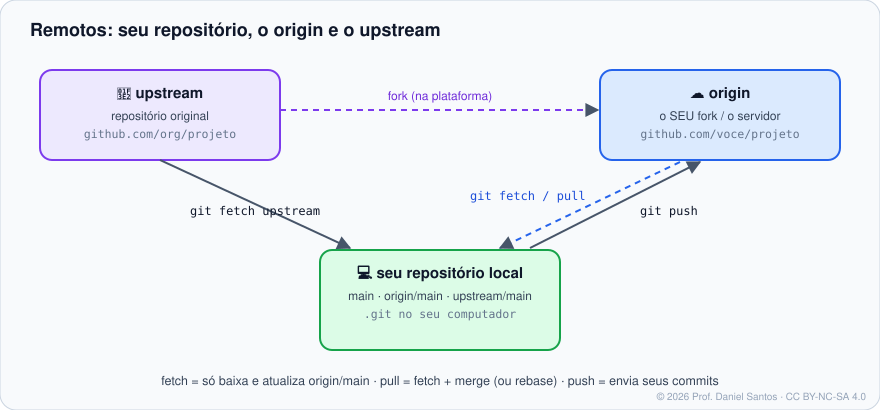

# Módulo 06 · Remotos e colaboração

> **Você vai sair daqui sabendo:** clonar, buscar, integrar e enviar commits; o que são `origin`, `upstream` e `origin/main`; configurar upstream de branches; escolher entre HTTPS e SSH e guardar credenciais com segurança; e colaborar por fork — tudo testado num “servidor” local antes de tocar em qualquer plataforma.

⏱ 5–6 h · 🧪 [Time simulado](../../laboratorio/#opção-c--time-simulado-sem-internet-sem-conta) · ✍️ [Exercícios](exercicios/)

---

## 1. Cenário

Até aqui o repositório vivia só na sua máquina. Agora o time da loja tem um servidor central (GitHub, GitLab, Bitbucket — ou um servidor da empresa). Você precisa baixar o projeto, trabalhar numa branch, publicar, receber o trabalho dos colegas e, num projeto open source, contribuir a partir de um **fork**.

## 2. O modelo



- Um **remoto** é só um apelido para a URL de outro repositório. O `git clone` cria o remoto **`origin`** automaticamente.
- **`origin/main`** é uma *branch de rastreamento remoto*: a **última posição conhecida** da `main` do servidor. Ela só muda quando você faz `fetch` (ou `pull`).
- **Upstream** tem dois sentidos que convivem: (1) a branch remota que a sua branch local acompanha (`main` → `origin/main`); (2) por convenção, o **remoto** apontando para o repositório **original** de um fork.
- O servidor guarda um repositório **bare** (sem diretório de trabalho). Você mesmo cria um com `git init --bare` — é o que o [laboratório](../../laboratorio/) faz.

## 3. Os quatro verbos

| Comando | O que faz | Variações |
|---|---|---|
| `git clone <url>` | copia o repositório inteiro (todo o histórico) e configura `origin` | `<url> pasta` · `--depth 1` · `--branch v2` · `--filter=blob:none` |
| `git fetch` | **baixa** commits novos e atualiza `origin/*`. Não mexe nas suas branches nem nos arquivos | `--all` · `--prune` · `--tags` |
| `git pull` | `fetch` + integra `origin/branch` na branch atual | `--rebase` · `--ff-only` · `--no-rebase` |
| `git push` | envia seus commits e move a branch no servidor | `-u origin nome` (primeira vez) · `--tags` · `--force-with-lease` · `origin --delete nome` |

> 🧠 `fetch` é **seguro sempre**: só atualiza `origin/*`. Por isso muitos profissionais fazem `git fetch` e depois decidem: `git merge origin/main`, `git rebase origin/main` ou só `git log main..origin/main` para ver o que chegou.

### O que o `pull` deve fazer quando as linhas divergem?

Desde o Git 2.27, se você não configurar, o Git **avisa** e pede uma escolha:

```bash
git config --global pull.rebase false   # merge (padrão histórico) — cria commit de merge quando divergiu
git config --global pull.rebase true    # rebase — histórico linear (Módulo 07)
git config --global pull.ff only        # só avanço rápido; se divergiu, falha e você decide
```

## 4. Branches remotas no dia a dia

```bash
git push -u origin feature/frete   # primeira publicação: cria a branch no servidor e liga o upstream
git status -sb                     # ## feature/frete...origin/feature/frete [ahead 2, behind 1]
git branch -vv                     # todas as branches com upstream e ahead/behind
git switch feature/do-colega       # se existir origin/feature/do-colega, o Git cria a local rastreando
git push origin --delete feature/frete   # apaga no servidor
git fetch --prune                  # remove origin/* de branches que não existem mais no servidor
```

`ahead 2` = você tem 2 commits que o servidor não tem (faltam `push`). `behind 1` = o servidor tem 1 que você não tem (falta integrar).

### Push recusado

```text
! [rejected]  main -> main (fetch first)
```

Alguém publicou antes. **Nunca** resolva com `--force`. Faça `git pull` (ou `fetch` + `rebase`), resolva conflitos se houver, teste e tente de novo.

Se você **precisa** reescrever uma branch sua já publicada (ex.: depois de um rebase na sua feature), use `git push --force-with-lease`: ele só sobrescreve se o servidor ainda estiver onde você viu pela última vez — não apaga o trabalho de alguém que publicou no meio-tempo.

## 5. HTTPS ou SSH? E as credenciais?

| | HTTPS | SSH |
|---|---|---|
| URL | `https://github.com/org/repo.git` | `git@github.com:org/repo.git` |
| Autenticação | **token** (senha de conta não funciona mais nas grandes plataformas) ou login pelo navegador | par de chaves |
| Guardar a credencial | *credential helper* | `ssh-agent` |
| Passa em firewall corporativo | quase sempre (porta 443) | às vezes bloqueado (porta 22) |

**HTTPS + Git Credential Manager** (instalado com o Git para Windows; disponível para macOS/Linux): login pelo navegador, credencial guardada no cofre do sistema.

```bash
git config --global credential.helper manager    # Windows/GCM
git config --global credential.helper osxkeychain # macOS
```

> ⚠️ `credential.helper store` grava o token **em texto puro** em `~/.git-credentials`. Evite.

**SSH:**

```bash
ssh-keygen -t ed25519 -C "voce@exemplo.com"   # gera ~/.ssh/id_ed25519 (privada) e .pub (pública)
cat ~/.ssh/id_ed25519.pub                       # cole na plataforma (Settings → SSH keys)
ssh -T git@github.com                           # teste a conexão
```

Cada plataforma tem o passo a passo detalhado no curso dela.

## 6. Colaborando por fork

1. Na plataforma, clique em **Fork**: nasce uma cópia sob a sua conta.
2. `git clone <url-do-SEU-fork>` → `origin` = seu fork.
3. `git remote add upstream <url-do-ORIGINAL>`.
4. Trabalhe numa branch, `git push -u origin minha-branch`, abra o Pull/Merge Request para o original.
5. Para atualizar o fork: `git fetch upstream && git switch main && git merge --ff-only upstream/main && git push origin main` — ou use [`scripts/dia-a-dia/sincronizar-fork.sh`](../../scripts/dia-a-dia/sincronizar-fork.sh).

## 7. Mão na massa

| Exemplo | O que demonstra |
|---|---|
| [`01-servidor-local.sh`](exemplos/01-servidor-local.sh) | repositório bare, clone, push, fetch e `origin/main` mudando |
| [`02-ahead-behind-e-rejeicao.sh`](exemplos/02-ahead-behind-e-rejeicao.sh) | duas pessoas, push recusado, `pull` com merge e com rebase, `--force-with-lease` |
| [`03-fork-e-upstream.sh`](exemplos/03-fork-e-upstream.sh) | o fluxo de fork completo com `origin` e `upstream` |

## 8. Exercícios

[exercicios/README.md](exercicios/) · `./ferramentas/corrigir.sh 06`

## 9. Boas práticas e armadilhas

- ✅ `git config --global fetch.prune true` — sem lixo de branches apagadas.
- ✅ `git config --global push.autoSetupRemote true` (Git 2.37+) — o primeiro `git push` de uma branch já cria o upstream.
- ✅ Antes de começar o dia: `git switch main && git pull`. Antes do PR: integre a `main` atual.
- ⚠️ Nunca `git push --force` em branch compartilhada. Proteja a `main` no servidor (cursos das plataformas).
- ⚠️ Token tem **escopo e validade**: crie com o mínimo de permissão e data de expiração.

## 📚 Fontes oficiais

- Pro Git: [2.5 Trabalhando com repositórios remotos](https://git-scm.com/book/pt-br/v2/Fundamentos-do-Git-Trabalhando-com-Reposit%c3%b3rios-Remotos) · [3.5 Branches remotos](https://git-scm.com/book/pt-br/v2/Ramifica%c3%a7%c3%a3o-Branching-no-Git-Branches-Remotos-Remote-Branches) · [5.1 Fluxos distribuídos](https://git-scm.com/book/pt-br/v2/Git-Distribu%c3%addo-Fluxos-de-Trabalho-Distribu%c3%addos) · [5.2 Contribuindo com um projeto](https://git-scm.com/book/pt-br/v2/Git-Distribu%c3%addo-Contribuindo-com-um-Projeto) · [7.14 Armazenamento de credenciais](https://git-scm.com/book/pt-br/v2/Ferramentas-do-Git-Armazenamento-de-Credenciais)
- Manual: [git-clone](https://git-scm.com/docs/git-clone) · [git-remote](https://git-scm.com/docs/git-remote) · [git-fetch](https://git-scm.com/docs/git-fetch) · [git-pull](https://git-scm.com/docs/git-pull) · [git-push](https://git-scm.com/docs/git-push) · [gitcredentials](https://git-scm.com/docs/gitcredentials)
- [Git Credential Manager](https://github.com/git-ecosystem/git-credential-manager)

---

⬅️ [Módulo 05](../05-conflitos/) · ➡️ [Módulo 07 · Reescrevendo o histórico](../07-reescrevendo-o-historico/)

<sub>© 2026 Prof. Daniel Santos · conteúdo [CC BY-NC-SA 4.0](../../LICENSE-CONTEUDO.md) · código [PolyForm Noncommercial](../../LICENSE)</sub>
