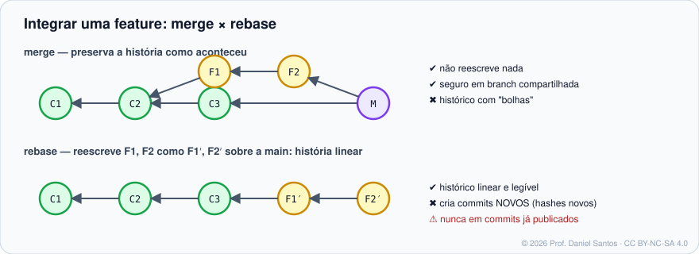

# Módulo 07 · Reescrevendo o histórico

> **Você vai sair daqui sabendo:** usar `rebase` para manter um histórico linear, o rebase **interativo** para limpar seus commits antes do Pull Request (juntar, reordenar, renomear, remover), `cherry-pick` para levar um commit específico a outra branch — e a regra que impede tudo isso de virar desastre.

⏱ 4–5 h · ✍️ [Exercícios](exercicios/)

---

## 1. Cenário

Sua branch `feature/cupom` tem 7 commits: `wip`, `ajuste`, `agora vai`, `corrige teste`… Enquanto isso a `main` andou 10 commits. Antes de abrir o Pull Request você quer (1) trazer a feature para cima da `main` atual e (2) transformar os 7 commits em 2 commits claros. Num outro dia, um *hotfix* feito na `main` precisa ir também para a branch `release/1.x` — sem levar o resto.

## 2. Merge × rebase



`git rebase main` (estando na feature) pega cada commit da feature que não está na `main` e o **reaplica**, um a um, em cima da ponta da `main`. Os commits reaplicados são **novos** (outro pai = outro hash), por isso aparecem com `′` no diagrama.

| | merge | rebase |
|---|---|---|
| Histórico | verdadeiro, com “bolhas” | linear, como se tudo fosse sequencial |
| Reescreve commits? | não | **sim** |
| Conflitos | resolvidos uma vez, no commit de merge | podem aparecer em cada commit reaplicado |
| Seguro em branch compartilhada? | sim | **não** |

## 3. A regra de ouro

> **Não faça rebase de commits que já foram publicados e que outras pessoas podem ter baseado trabalho.**

Rebase na **sua** feature, antes do PR, é ótimo. Rebase da `main` compartilhada é como trocar as páginas de um livro que outras pessoas estão lendo. Se você reescrever uma branch sua já publicada, envie com `git push --force-with-lease` (Módulo 06).

## 4. Rebase interativo

```bash
git rebase -i HEAD~4        # ou: git rebase -i main (todos os commits da feature)
```

O editor abre uma lista (do mais antigo para o mais novo). Você troca a palavra do começo da linha:

```text
pick   a1b2c3d feat: modelo de cupom
squash d4e5f6a wip                      ← junta ao anterior e deixa você editar a mensagem
fixup  0a1b2c3 corrige teste            ← junta ao anterior DESCARTANDO esta mensagem
reword 9f8e7d6 fet: valida cupom        ← mantém o commit, troca a mensagem
drop   5c4b3a2 debug temporário         ← remove o commit
```

| Comando | Efeito |
|---|---|
| `pick` | mantém |
| `reword` (`r`) | mantém e edita a mensagem |
| `edit` (`e`) | para no commit para você alterar (amend) e depois `git rebase --continue` |
| `squash` (`s`) | junta ao anterior, combinando mensagens |
| `fixup` (`f`) | junta ao anterior, descartando a mensagem |
| `drop` (`d`) | remove |
| reordenar linhas | reordena commits |
| `exec` (`x`) | roda um comando (ex.: testes) depois de cada commit |

Durante o rebase: `git rebase --continue` (depois de resolver um conflito e dar `add`), `--skip` (pular este commit), `--abort` (voltar ao começo). Deu errado depois de terminar? `git reset --hard ORIG_HEAD` ou o `reflog`.

### O atalho profissional: `--fixup` + `--autosquash`

```bash
git commit --fixup=a1b2c3d       # cria "fixup! feat: modelo de cupom"
git rebase -i --autosquash main  # o Git já posiciona e marca os fixups
```

Com `rebase.autoSquash true` no `.gitconfig`, o `--autosquash` vira padrão.

> 💡 Em scripts e CI dá para rodar o rebase interativo sem editor, com `GIT_SEQUENCE_EDITOR` (os exemplos e as soluções deste módulo fazem isso). É também como as plataformas implementam o botão “Rebase and merge”.

## 5. Outras formas de reescrever

| Necessidade | Comando |
|---|---|
| mover a feature para outra base | `git rebase --onto nova-base base-antiga feature` |
| atualizar branches empilhadas juntas | `git rebase --update-refs main` (Git 2.38+) |
| juntar os N últimos commits sem editor | `git reset --soft HEAD~N && git commit` |
| trazer **um** commit de outra branch | `git cherry-pick <commit>` |
| … anotando de onde veio | `git cherry-pick -x <commit>` (acrescenta “cherry picked from commit …”) |
| um intervalo | `git cherry-pick A..B` |
| remover um arquivo de **todo** o histórico | [`git filter-repo`](https://github.com/newren/git-filter-repo) (Módulo 11) |

## 6. Mão na massa

| Exemplo | O que demonstra |
|---|---|
| [`01-rebase-linear.sh`](exemplos/01-rebase-linear.sh) | a mesma feature integrada por merge e por rebase; hashes novos |
| [`02-rebase-interativo.sh`](exemplos/02-rebase-interativo.sh) | squash, fixup, reword e drop — automatizados com `GIT_SEQUENCE_EDITOR` |
| [`03-cherry-pick.sh`](exemplos/03-cherry-pick.sh) | levar um hotfix da `main` para `release/1.x` com `-x` |

## 7. Exercícios

[exercicios/README.md](exercicios/) · `./ferramentas/corrigir.sh 07`

## 8. Boas práticas e armadilhas

- ✅ Limpe os seus commits **antes** do PR; depois do review, prefira commits novos (facilita a releitura de quem revisa).
- ✅ `git rebase -i --exec "make test" main` garante que **cada** commit passa nos testes — essencial para o `bisect` (Módulo 09).
- ⚠️ Rebase de uma branch com merges dentro pode surpreender; veja `--rebase-merges`.
- ⚠️ Cherry-pick duplica o commit (hash diferente). Se depois as duas branches forem mescladas, o Git normalmente percebe, mas abuse com cuidado.

## 📚 Fontes oficiais

- Pro Git: [3.6 Rebase](https://git-scm.com/book/pt-br/v2/Ramifica%c3%a7%c3%a3o-Branching-no-Git-Rebase-Rebasing) · [7.6 Reescrevendo o histórico](https://git-scm.com/book/pt-br/v2/Ferramentas-do-Git-Reescrevendo-o-Hist%c3%b3rico) · [5.3 Mantendo um projeto (cherry-pick)](https://git-scm.com/book/pt-br/v2/Git-Distribu%c3%addo-Mantendo-um-Projeto)
- Manual: [git-rebase](https://git-scm.com/docs/git-rebase) · [git-cherry-pick](https://git-scm.com/docs/git-cherry-pick) · [git-commit (opção --fixup)](https://git-scm.com/docs/git-commit)

---

⬅️ [Módulo 06](../06-remotos-e-colaboracao/) · ➡️ [Módulo 08 · Fluxos, tags e releases](../08-fluxos-tags-e-releases/)

<sub>© 2026 Prof. Daniel Santos · conteúdo [CC BY-NC-SA 4.0](../../LICENSE-CONTEUDO.md) · código [PolyForm Noncommercial](../../LICENSE)</sub>
