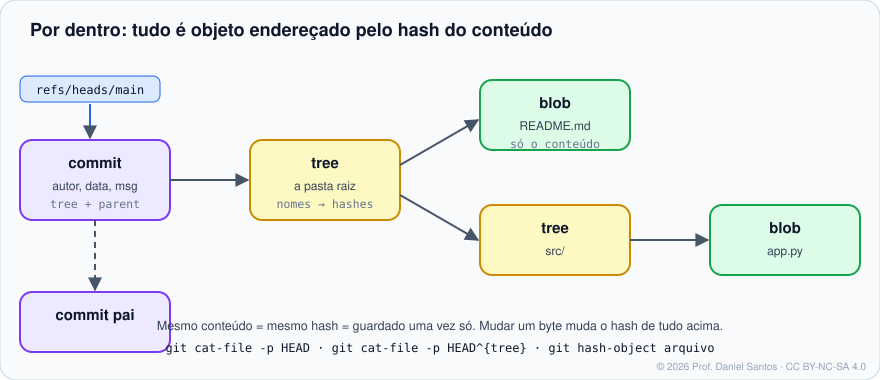

# Módulo 10 · Por dentro do Git

> **Você vai sair daqui sabendo:** como o Git guarda os dados — objetos *blob*, *tree*, *commit* e *tag* endereçados pelo hash do conteúdo —, o que são as referências, como os *packfiles* economizam espaço, e usar os comandos de **encanamento** para inspecionar e até construir um commit à mão. Com isso, nenhum comportamento do Git volta a parecer mágica.

⏱ 4–5 h · ✍️ [Exercícios](exercicios/)

---

## 1. Por que olhar por dentro?

Porque todos os módulos anteriores ficam óbvios: o `reflog` recupera commits porque objetos não somem na hora; branches são baratas porque são só ponteiros; rebase cria commits “novos” porque o hash depende do pai; um arquivo de 200 MB commitado e apagado continua pesando porque o objeto ainda está no histórico.

## 2. O Git é um banco de dados chave-valor



| Objeto | Guarda | Inspecionar |
|---|---|---|
| **blob** | o **conteúdo** de um arquivo (sem nome, sem permissões) | `git cat-file -p <hash>` |
| **tree** | uma pasta: lista de nomes → (modo, tipo, hash) | `git cat-file -p HEAD^{tree}` · `git ls-tree HEAD` |
| **commit** | hash da tree raiz, pai(s), autor, committer, mensagem | `git cat-file -p HEAD` |
| **tag** (anotada) | objeto apontado, nome, autor, mensagem, assinatura | `git cat-file -p v1.0` |

A **chave** de cada objeto é o hash do seu conteúdo (com um cabeçalho `tipo tamanho\0`). Consequências:

- Mesmo conteúdo → mesmo hash → guardado **uma vez** (dois arquivos iguais em pastas diferentes = um blob).
- Mudou um byte → hash novo → tree nova → commit novo → e todos os commits filhos também. É por isso que o histórico é à prova de adulteração silenciosa.

```bash
echo 'olá' | git hash-object --stdin        # o id que esse conteúdo teria
git cat-file -t HEAD                        # tipo: commit
git cat-file -s HEAD:README.md              # tamanho do blob
git rev-parse HEAD~2^{tree}                 # hash da tree raiz de um commit antigo
```

### SHA-1, SHA-256 e o Git 3.0

Historicamente o Git usa SHA-1 (40 hex). Desde 2017 há colisões práticas de SHA-1; o Git usa uma versão endurecida (*sha1dc*) que detecta esses ataques, e desde a versão 2.29 suporta repositórios **SHA-256** (64 hex): `git init --object-format=sha256`. O plano para o **Git 3.0** é tornar SHA-256 o padrão em repositórios novos; a adoção depende das plataformas aceitarem esse formato. Fonte: [BreakingChanges](https://git-scm.com/docs/BreakingChanges) · [hash-function-transition](https://git-scm.com/docs/hash-function-transition).

## 3. Referências

| Referência | Onde (formato tradicional) | O que é |
|---|---|---|
| branch | `.git/refs/heads/main` | hash do commit da ponta |
| tag | `.git/refs/tags/v1.0` | hash do objeto tag (anotada) ou do commit (leve) |
| remota | `.git/refs/remotes/origin/main` | última posição conhecida no servidor |
| `HEAD` | `.git/HEAD` | `ref: refs/heads/main` (ou um hash, se destacado) |
| empacotadas | `.git/packed-refs` | muitas refs num arquivo só |

O **reftable** (`git init --ref-format=reftable`, Git 2.45+) troca esses arquivos por um formato binário mais rápido e atômico — planejado como padrão no Git 3.0. Por isso, em scripts, **nunca leia `.git/refs` diretamente**: use `git rev-parse`, `git for-each-ref`, `git update-ref`.

## 4. Onde ficam os objetos

- **Soltos** (*loose*): `.git/objects/ab/cdef…` — um arquivo comprimido (zlib) por objeto.
- **Empacotados** (*packfiles*): `.git/objects/pack/*.pack` + `.idx` — muitos objetos num arquivo, guardando **deltas** entre versões parecidas. É assim que um histórico de anos cabe em poucos MB.

```bash
git count-objects -vH       # soltos × empacotados, tamanho
git gc                      # empacota e limpa (o Git roda sozinho às vezes)
git verify-pack -v .git/objects/pack/*.idx | sort -k3 -n | tail -5   # maiores objetos do pack
git fsck                    # integridade; --lost-found acha commits órfãos
```

Objetos inalcançáveis (de um `reset --hard`, por exemplo) só são apagados quando ficam mais velhos que `gc.pruneExpire` (padrão: 2 semanas) **e** não estão no reflog (90 dias, ou 30 para entradas inalcançáveis). Daí a “rede de segurança” do Módulo 03.

## 5. Porcelana construída sobre encanamento

Um `git commit` é, por baixo:

```bash
git hash-object -w arquivo.txt                     # 1. grava o blob
git update-index --add --cacheinfo 100644,<blob>,arquivo.txt   # 2. põe no índice
git write-tree                                     # 3. grava a tree a partir do índice
git commit-tree <tree> -p <pai> -m "mensagem"      # 4. grava o commit
git update-ref refs/heads/main <commit>            # 5. move a branch
```

O exercício 02 pede exatamente isso.

## 6. Variáveis de ambiente úteis

| Variável | Para quê |
|---|---|
| `GIT_TRACE=1` | mostra os comandos internos executados |
| `GIT_TRACE_PACKET=1` | conversa de rede com o servidor |
| `GIT_AUTHOR_NAME/EMAIL/DATE`, `GIT_COMMITTER_*` | identidade e data de um commit (usado nos testes do curso) |
| `GIT_DIR`, `GIT_WORK_TREE` | apontar para outro repositório/árvore |
| `GIT_CONFIG_GLOBAL`, `GIT_CONFIG_NOSYSTEM` | isolar configuração (o curso usa nos exemplos) |

## 7. Mão na massa

| Exemplo | O que demonstra |
|---|---|
| [`01-objetos.sh`](exemplos/01-objetos.sh) | blobs, trees, commits e tags com `cat-file`; deduplicação por conteúdo |
| [`02-commit-a-mao.sh`](exemplos/02-commit-a-mao.sh) | um commit construído só com encanamento |
| [`03-refs-e-packs.sh`](exemplos/03-refs-e-packs.sh) | refs, `packed-refs`, `gc`, objetos inalcançáveis e repositório SHA-256 |

## 8. Exercícios

[exercicios/README.md](exercicios/) · `./ferramentas/corrigir.sh 10`

## 📚 Fontes oficiais

- Pro Git: [10.1 Encanamento e porcelana](https://git-scm.com/book/pt-br/v2/Git-Internals-Por-Dentro-do-Git-Encanamento-e-Porcelana-Plumbing-and-Porcelain) · [10.2 Objetos](https://git-scm.com/book/pt-br/v2/Git-Internals-Por-Dentro-do-Git-Objetos-do-Git) · [10.3 Referências](https://git-scm.com/book/pt-br/v2/Git-Internals-Por-Dentro-do-Git-Refer%c3%aancias-do-Git) · [10.4 Packfiles](https://git-scm.com/book/pt-br/v2/Git-Internals-Por-Dentro-do-Git-Arquivos-de-pacote-Packfiles) · [10.7 Manutenção e recuperação](https://git-scm.com/book/pt-br/v2/Git-Internals-Por-Dentro-do-Git-Manuten%c3%a7%c3%a3o-e-Recupera%c3%a7%c3%a3o-de-Dados) · [10.8 Variáveis de ambiente](https://git-scm.com/book/pt-br/v2/Git-Internals-Por-Dentro-do-Git-Vari%c3%a1veis-de-Ambiente)
- Manual: [git-cat-file](https://git-scm.com/docs/git-cat-file) · [git-hash-object](https://git-scm.com/docs/git-hash-object) · [git-commit-tree](https://git-scm.com/docs/git-commit-tree) · [git-update-ref](https://git-scm.com/docs/git-update-ref) · [gitrepository-layout](https://git-scm.com/docs/gitrepository-layout) · [git-gc](https://git-scm.com/docs/git-gc) · [hash-function-transition](https://git-scm.com/docs/hash-function-transition)

---

⬅️ [Módulo 09](../09-ferramentas-avancadas/) · ➡️ [Módulo 11 · Segurança, hooks e automação](../11-seguranca-hooks-e-automacao/)

<sub>© 2026 Prof. Daniel Santos · conteúdo [CC BY-NC-SA 4.0](../../LICENSE-CONTEUDO.md) · código [PolyForm Noncommercial](../../LICENSE)</sub>
